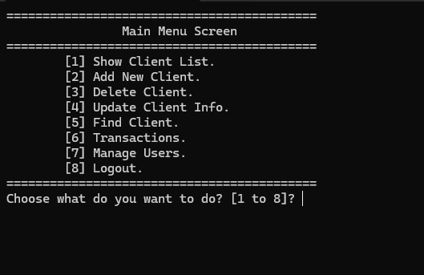
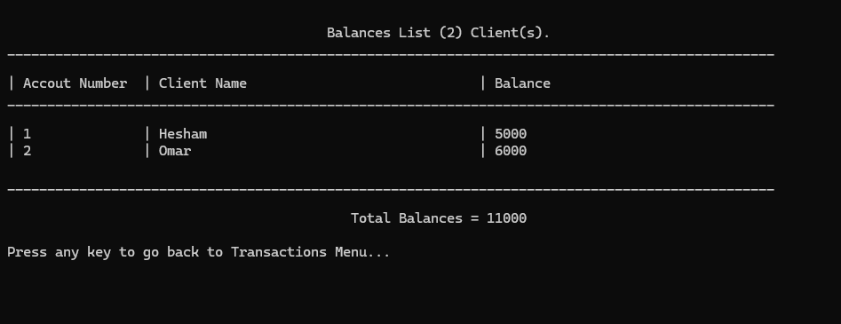
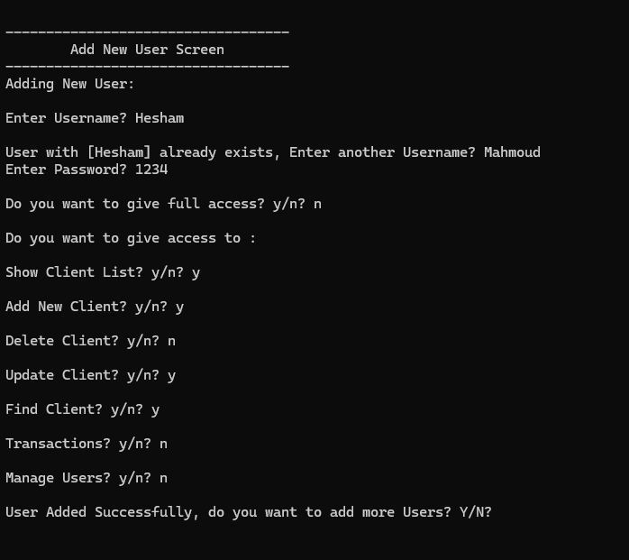

# Bank Management System

A console-based Bank Management System developed in C++.

This was my third C++ project, built using text-file storage (`.txt` files) to practice procedural programming, function organization, file handling, and data management.

The application allows users to log in, manage client records, perform banking transactions, and manage system users with customizable access permissions. Client and user records are stored in text files, allowing the data to persist between application sessions.

## Features

- User login and authentication
- Client management:
  - List all clients
  - Add new clients
  - Delete client records
  - Update client information
  - Search for clients by account number
- Banking transactions:
  - Deposit funds
  - Withdraw funds
  - Display individual client balances
  - Calculate total client balances
- User management:
  - List users
  - Add new users
  - Delete users
  - Update user information
  - Search for users by username
- Customizable user permissions
- Full-access option for administrators
- Permission checks for restricted menu operations
- Persistent data storage using `.txt` files
- Console-based menu navigation

## Screenshots

### Main Menu



### Banking Transactions



### User Management



## Technologies

- **C++**
- Standard Library
  - `iostream`
  - `fstream`
  - `string`
  - `vector`
  - `iomanip`

## Concepts Demonstrated

This project was developed to practice C++ programming concepts, including:

- Procedural programming and functional decomposition
- Enumerations (`enum`)
- Structures (`struct`)
- Functions and references
- Arrays and vectors
- File handling and persistent storage
- Reading and writing text files
- String manipulation and parsing
- CRUD operations (Create, Read, Update, Delete)
- Conditional statements and `switch` statements
- Loops
- Type casting and numeric conversions
- Bitwise operations for permission management
- User authentication and access control
- Basic data serialization and deserialization

## Data Storage

The application uses two text files to store its data:

- `Clients.txt` — stores client account numbers, PIN codes, names, phone numbers, and account balances.
- `Users.txt` — stores usernames, passwords, and permission values.

Each record is converted into a delimited text line using `#//#` as the field separator.

The application loads records from these files when needed and writes changes back to the files, allowing client and user data to persist between sessions.

## How It Works

1. The application displays a login screen.
2. The user enters a username and password.
3. After successful authentication, the main menu is displayed.
4. The user can manage client records, access banking transactions, or manage system users, depending on their permissions.
5. Client information and user accounts can be created, searched, updated, and deleted.
6. Deposit and withdrawal operations update client account balances.
7. The application stores changes in the corresponding text files.
8. Users can log out and return to the login screen.

## How to Run

### Requirements

- Windows operating system
- Visual Studio with C++ development tools installed

### Using Visual Studio

1. Clone the repository:

```bash
git clone https://github.com/HeshamSallem510/Bank-Management-System-CPP.git
```

2. Open the solution in Visual Studio.
3. Build the solution.
4. Run the application.

> The current implementation uses Windows-specific console commands, including `system("cls")` and `system("pause>0")`, so it is intended for Windows.

> The repository includes Clients.txt and Users.txt with sample data to make it easier to run and explore the application.

## Future Improvements

- Improve input validation and error handling.
- Hash passwords instead of storing them as plain text.
- Strengthen transaction validation and account-balance checks.
- Separate the application into multiple source and header files.
- Introduce a database for more scalable data storage.
- Improve the menu interface and user experience.

## Author

**Hesham Elsayed**